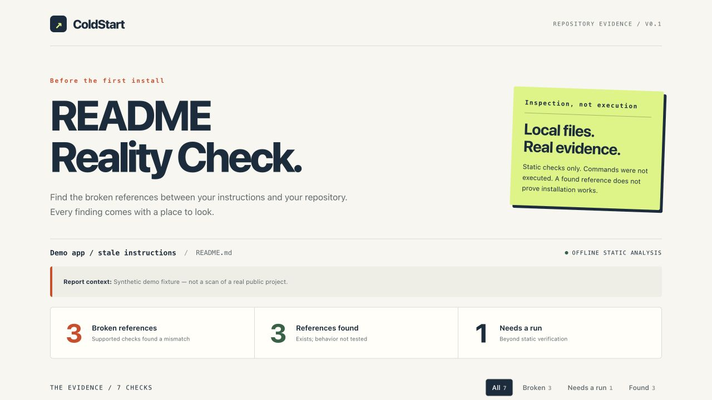

# ColdStart

[](https://github.com/hzw0813/coldstart/actions/workflows/test.yml)

**Catch stale README commands before your next contributor does.**

ColdStart compares shell snippets in an existing README with the files and package scripts in a local checkout. It produces line-numbered evidence you can inspect in the terminal, attach as Markdown, or open as an offline HTML report.

Early-stage v0.1.0. Python 3.10+. No runtime dependencies, account, API key, telemetry, or project-command execution.

[Interactive synthetic demo](https://hzw0813.github.io/coldstart/) · [Real-project study](docs/real-world-study.md) · [Releases](https://github.com/hzw0813/coldstart/releases)

## Install

Clone this repository, then run from its directory:

```sh
python3 -m pip install .
```

You can also run directly from the source checkout with `python3 -m coldstart`. The distribution is not on PyPI; use this repository or its release assets.



The screenshot and included examples use **synthetic fixtures**, not findings against a real public project. The report checks references, not successful installation.

## Try the included demo

From this project's directory:

```sh
python3 -m coldstart examples/broken
```

The deliberately stale example contains three broken references: a missing npm script, a missing requirements file, and a missing Python script. An exit status of **1 is expected**.

```sh
python3 -m coldstart examples/fixed
```

The repaired fixture has no known broken references. It still contains an unverified install command: ColdStart does not run it.

Create a portable report:

```sh
python3 -m coldstart examples/broken --format html --output report.html
```

Open `report.html` in a browser. It uses no external fonts, scripts, or services. Evidence may contain proprietary paths or commands from your README; review it before sharing.

The labelled demo artifacts in `docs/` can be regenerated with `python3 -m examples.generate_reports` from the project root.

## Check your project

Run from ColdStart's directory, supplying a local repository path:

```sh
python3 -m coldstart /path/to/your/project
```

Or install from this source checkout with `python3 -m pip install .` and then use `coldstart /path/to/your/project`. The package has **not been published to PyPI**; do not assume a similarly named package is this project.

Options:

| Option | Purpose |
| --- | --- |
| `--readme docs/setup.md` | Read a document relative to the project root |
| `--format text\|json\|markdown\|html` | Select output format |
| `--output report.html` | Save the report instead of printing it |
| `--strict` | Also return failure when any step is unverified |

Exit codes: **0** = no known broken references; **1** = broken references, or unverified steps under `--strict`; **2** = input/read/write error. Exit 0 is never proof that onboarding works.

## What v0.1 checks

- Shell fenced blocks and simple relative `cd` paths, including `cd web && npm run dev`.
- Explicit package script references in `npm`, `pnpm`, `yarn`, and `bun` commands. When a package manager could resolve a name as a binary or file, an absent script may be unverified instead of broken.
- Explicit Python script paths and requirements files passed to `pip install -r`.
- Local Python module entry points (`python -m module`) and literal shell script references (`bash runs/setup.sh`). Missing modules remain unverified because installed dependencies may provide them.
- Source line numbers, the command under review, and the local evidence behind each result.

Each fenced block begins at the project root. A document under `docs/` also begins at the project root. This is a documented convention, not inferred shell history. Use a `cd` inside a block to change its working directory.

## What a result means

| Status | Meaning |
| --- | --- |
| **Broken reference** | A supported command refers to a missing item in the inspected snapshot |
| **Reference found** | The item exists; its contents and runtime behavior have not been validated |
| **Needs a run** | The static checker cannot establish the claim |

Complex shell logic, variable expansion, installation, remote services, implicit generated files, package-manager workspace flags, and unsupported command forms need separate verification. An unknown or potentially mutating command makes later steps in the same block unverified. ColdStart does not install dependencies, follow repository instructions, validate every Markdown construct, test application behavior, or model a real shell. It does not read references that escape the chosen root through traversal or symbolic links.

The scan is based on current filesystem contents, not a clean Git checkout. Large input files are rejected. See the executable tests for the currently supported syntax and edge cases.

## Why another documentation tool?

This is a small static preflight for existing README files. [byexample](https://github.com/byexamples/byexample) tests documentation examples and expected output; [RunDOC](https://github.com/zombocom/rundoc) runs scripts to generate documentation. [clean-room-check](https://github.com/Wasserpuncher/clean-room-check) and [readme2demo](https://github.com/alphacrack/readme2demo) address runtime setup verification. ColdStart overlaps with README auditing tools; it does not claim a new category or replace execution-based checks.

The intended contribution is an easy-to-review, conservative checker with shareable evidence and an explicit unverified state. Real-world usefulness still needs validation.

## Development and CI

```sh
python3 -m unittest discover -s tests -v
```

The included GitHub Actions workflow runs this test suite. For another project, install a reviewed, pinned release of ColdStart once releases are available and run the CLI against the checked-out repository. v0.1 does not include a published GitHub Action; use the CLI or a pinned source checkout.

Good first contributions: an unsupported command fixture, a false-positive regression test, documentation improvements, or a carefully scoped package-manager adapter. See [CONTRIBUTING.md](CONTRIBUTING.md).

## Project status

Implemented: local scanner, terminal/JSON/Markdown/HTML outputs, fixtures, and 83 automated tests. CI passes on Python 3.10, 3.12, and 3.14. The eight-project study can be reproduced from a fresh clone; see [validation evidence](docs/validation.txt).

Not yet established: external adoption, user testimonials, or production reliability across arbitrary READMEs.

The [real-project study](docs/real-world-study.md) records fixed upstream commits, raw results, and coverage limits. Testing a project is not adoption or endorsement by that project's maintainers.

MIT licensed.
